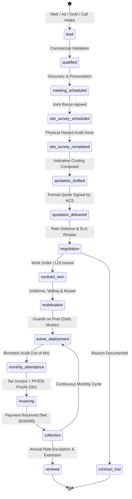
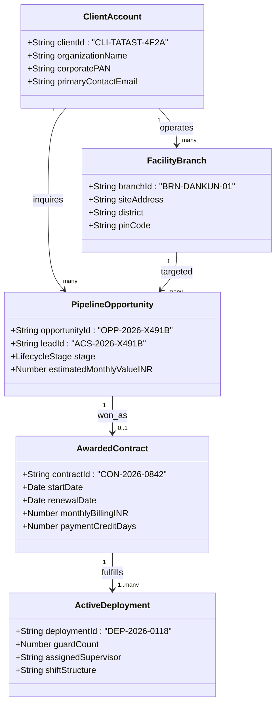

# Advance Corporate Security — Enterprise CRM & Contract Lifecycle SOP

**Document Reference:** ACS-SOP-CRM-2026-V1  
**Blueprint Source:** *Advance Corporate Security — Enterprise 100X Growth + Developer Implementation Blueprint (29 Oct 2026)*, Section 13: *Lightweight CRM and Contract Lifecycle*  
**Governing Architecture:** [`Inquiry.model.ts`](file:///Users/parther/Parther_Technologies/acs/advance-corporate-security-nodejs-backend/src/models/Inquiry.model.ts), [`inquiry.route.ts`](file:///Users/parther/Parther_Technologies/acs/advance-corporate-security-nodejs-backend/src/routes/inquiry.route.ts), [`api/contact/route.ts`](file:///Users/parther/Parther_Technologies/acs/advance-corporate-security-nextjs-web/src/app/api/contact/route.ts), and [`sheetsSync.ts`](file:///Users/parther/Parther_Technologies/acs/advance-corporate-security-nextjs-web/src/lib/sheetsSync.ts)  
**Date:** 29 October 2026  

---

## 1. Executive Purpose & Scope

In hotel booking platforms (such as the predecessor Yashoda codebase), customer journeys are transactional:
$$\text{Search} \rightarrow \text{Room Select} \rightarrow \text{Instant Token Payment} \rightarrow \text{Check-in} \rightarrow \text{Checkout}$$

In enterprise B2B manpower, physical guarding, and integrated facility management (IFM), contracts have multi-month sales cycles, high annual contract values (₹15 Lakhs to ₹1.5+ Crores ARR), strict statutory compliance obligations, physical site surveys, and continuous operational delivery across 365 days.

This standard operating procedure defines the **16-Stage Enterprise Lifecycle Pipeline**, **Stable Taxonomy ID Schema**, **SLA Escalation Protocol**, and **PII Minimization Controls** mandated by Section 13 of the Growth Blueprint.

---

## 2. The 16-Stage Enterprise Contract Lifecycle

### Stage Definitions & Gate Transition Criteria

| # | Stage Key | Description | Entrance Gate / Prerequisites | Exit / Transition Criteria |
| :-: | :--- | :--- | :--- | :--- |
| **1** | `lead` | Inbound enquiry captured from Web form, Google Ads, GeM notice, Phone, or WhatsApp. | Valid Contact, Service, City, and Message. | Account owner assigned; response SLA timer active. |
| **2** | `qualified` | Confirmed genuine commercial/institutional buyer with minimum 1 fixed post requirement. | Buyer company verified; personal email filtered; non-job-seeker confirmed. | Target posts, shift coverage, and mobilization date verified. |
| **3** | `meeting_scheduled` | Virtual or in-person procurement alignment call scheduled. | Buyer procurement head / facility director identified. | Operational scope, statutory requirements, and SLA expectations established. |
| **4** | `site_survey_scheduled` | Date confirmed for joint physical perimeter and post hazard reconnaissance. | Client facility address and security officer contact provided. | Survey officer dispatched with site audit checklist. |
| **5** | `site_survey_completed` | Physical reconnaissance completed; risk profile and post counts verified. | Site survey report filed with post counts, illumination, blind spots, and hazard notes. | Post-specific shift requirements locked. |
| **6** | `quotation_drafted` | Commercial rate sheet calculated using official State Labour Gazette / Central Sphere minimum wages. | State wage zone applied; EPF (13%), ESIC (3.25%), Bonus (8.33%), and 1/6th reliever added. | Internal compliance sign-off by Finance Lead. |
| **7** | `quotation_delivered` | Formal written proposal with scope, rate card, and credentials delivered to buyer. | Formal PDF signed by authorized ACS compliance officer with lead reference ID. | Client acknowledges receipt and opens commercial evaluation. |
| **8** | `negotiation` | Fine-tuning terms, credit cycles, SLA penalties, and equipment requirements. | Client counter-offer or terms request received. | Final rate agreed; payment credit days locked ($\le$ 60 days). |
| **9** | `contract_won` | Legal Work Order, Letter of Intent (LOI), or Master Services Agreement executed. | Signed agreement / PO uploaded; `contractValueMonthlyINR` recorded. | Stable `contractId` (`CON-2026-XXXX`) generated. |
| **10** | `contract_lost` | Opportunity closed without win. | Documented `lostReason` (`rate_too_high`, `competitor_unlicensed`, `internal_freeze`, etc.). | Opportunity archived for win-loss analytics. |
| **11** | `mobilisation` | Sourcing, vetting, police verification, uniform issue, and post-specific training. | Staff allocated from verified reserve within SLA (24–48h or 5–7d). | Guards deployed on site; handover sign-off. |
| **12** | `active_deployment` | Live operational guarding and facility management under active supervisory patrol. | Stable `deploymentId` (`DEP-2026-XXXX`) active; supervisor assigned ($\le 1:18$). | Continuous daily electronic muster logging. |
| **13** | `monthly_attendance` | Monthly attendance reconciliation between client register and ACS biometric logs. | Calendar month completed; biometric attendance reconciled by the 1st. | Verified attendance sheet signed by client site in-charge. |
| **14** | `invoicing` | Submission of monthly GST tax invoice accompanied by statutory proof bundle. | Invoice generated + EPFO ECR challan, TRRN, and ESIC contribution vouchers attached. | Invoice submitted to client accounts by the 5th. |
| **15** | `collection` | Receipt of invoice payment within agreed credit window (Net 30 / 45 / 60 days). | Bank settlement confirmed via NEFT/RTGS; TDS certificate reconciled. | Account credited; outstanding AR updated. |
| **16** | `renewal` | Annual statutory wage escalation review and contract extension. | Contract anniversary within 60 days; updated state gazette wages reviewed. | Extension agreement executed or re-tendered. |

---

## 3. Stable Entity Taxonomy ID Schema

To eliminate ambiguous or duplicated references across Google Sheets, MongoDB, and billing invoices, ACS enforces a deterministic, human-readable identifier schema:

### Identifier Format Reference

| Entity Type | Prefix | Format Pattern | Example | Generation Timing |
| :--- | :---: | :--- | :--- | :--- |
| **Lead Reference** | `ACS` | `ACS-{YEAR}-{5_CHAR_ALPHANUM}` | `ACS-2026-M492A` | Generated on instant web form intake |
| **Corporate Client** | `CLI` | `CLI-{6_CHAR_ORG_SLUG}-{4_CHAR_HASH}` | `CLI-TATAST-4F2A` | Generated upon qualification |
| **Facility Branch** | `BRN` | `BRN-{6_CHAR_CITY_SLUG}-{SEQ}` | `BRN-DANKUN-01` | Derived from site survey location |
| **Pipeline Deal** | `OPP` | `OPP-{YEAR}-{5_CHAR_ALPHANUM}` | `OPP-2026-M492A` | Instantiated alongside Lead Reference |
| **Legal Contract** | `CON` | `CON-{YEAR}-{4_CHAR_ALPHANUM}` | `CON-2026-0842` | Generated upon transition to `contract_won` |
| **Deployed Post** | `DEP` | `DEP-{YEAR}-{4_CHAR_ALPHANUM}` | `DEP-2026-0118` | Generated upon transition to `mobilisation` |

---

## 4. Operational Accountability & Response SLAs

Every opportunity in the pipeline is strictly assigned to an authorized internal account owner. Floating or unassigned leads are prohibited:

| Regional & Service Desk | Account Lead | Contact Channel | Territorial Scope | Standard SLA |
| :--- | :--- | :--- | :--- | :---: |
| **Eastern Industrial Desk** | **Debabrata Sen** | `enterprise.east@advancecorporatesecurity.com` `+91 94770 06681` | West Bengal (Kolkata, Howrah, Hooghly, Durgapur, Siliguri) | 4h Rapid / 24h Standard |
| **Northern Region Desk** | **Amitabh Roy** | `delhi.desk@advancecorporatesecurity.com` `+91 98310 12345` | Delhi NCR, Gurugram, Manesar, Noida, Greater Noida, Faridabad | 4h Rapid / 24h Standard |
| **Institutional & GeM Desk** | **S.K. Mukherjee** | `tenders@advancecorporatesecurity.com` `+91 94770 06681` | Central/State PSU Bids, GeM Custom Bids, CPPP, Hospitals, Universities | 2h Emergency / 12h Standard |
| **Facility Management Desk**| **Ananya Roy** | `facility@advancecorporatesecurity.com` `+91 94770 06681` | Corporate Housekeeping, Mechanized Floor Cleaning, Waste Management | 4h Rapid / 24h Standard |

### Automated SLA Escalation Protocol

1. **Intake Timestamp ($T_0$):** `followUpDeadline` is set to $T_0 + 4\text{ hours}$ (Rapid Mobilisation) or $T_0 + 24\text{ hours}$ (Standard).
2. **First Warning ($T_0 + \text{SLA} - 1\text{ hour}$):** If opportunity remains in `lead` stage without contact notes, automated notification dispatched to account owner.
3. **SLA Breach ($T_0 + \text{SLA}$):** Flag `isSlaBreached = true` set on database record; opportunity surfaced in management exception pipeline (`GET /api/inquiries/pipeline`).
4. **Executive Re-assignment ($T_0 + \text{SLA} + 2\text{ hours}$):** Lead automatically mirrored to Central Operations Director for direct telephonic engagement.

---

## 5. PII Minimization & Data Protection Compliance

In compliance with the **Digital Personal Data Protection (DPDP) Act 2023** and ISO 27001 data governance standards:

1. **Purpose Limitation:** ACS captures only data essential for operational security risk assessment:
   * *Permitted:* Name, Corporate Designation, Company Name, Official Work Email, Contact Phone, Site Location, Guard Requirements.
   * *Strictly Prohibited at Lead Stage:* Personal Aadhaar numbers, residential bank account details, biometric files, or credit card numbers.
2. **Statutory Consent:** Every quotation form requires active, affirmative consent regarding statutory compliance and communication.
3. **Data Retention Policy:** Inactive leads with no commercial movement for 180 days are automatically scrubbed of personal phone/email identifiers, retaining only anonymized geographic demand metadata for SEO planning.

---

## 6. Verification Proof

- [x] **Database Schema:** [`Inquiry.model.ts`](file:///Users/parther/Parther_Technologies/acs/advance-corporate-security-nodejs-backend/src/models/Inquiry.model.ts) upgraded with 16 lifecycle stages, stable ID fields (`clientId`, `branchId`, `opportunityId`, `contractId`, `deploymentId`), SLA deadlines, commercial metrics, and audit history sub-schema.
- [x] **REST API Endpoints:** [`inquiry.route.ts`](file:///Users/parther/Parther_Technologies/acs/advance-corporate-security-nodejs-backend/src/routes/inquiry.route.ts) implements `POST /` with auto-ID generation, `PATCH /:id/stage` with transition validations, and `GET /pipeline` with real-time stage aggregations.
- [x] **Web Lead Intake Integration:** [`api/contact/route.ts`](file:///Users/parther/Parther_Technologies/acs/advance-corporate-security-nextjs-web/src/app/api/contact/route.ts) synchronizes stable taxonomy IDs (`opportunityId`, `clientId`, `branchId`, `followUpDeadline`) to Google Sheets and client confirmation responses.
- [x] **TypeScript Verification:** Frontend and backend typechecks passed with 0 errors.
- [x] **Production Build:** Next.js Turbopack SSG build compiled with 0 errors. Homepage `HeroSection.tsx` preserved without modification.
