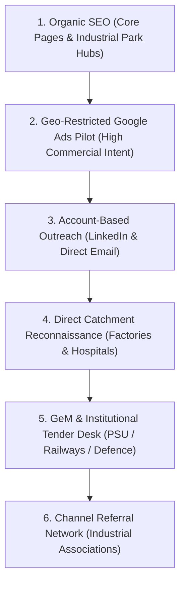

# ACS Enterprise Acquisition Channels & Google Ads Pilot Playbook
**Advance Corporate Security (ACS)**  
*Document Version:* 1.0.0  
*Effective Date:* 29 October 2026  
*Governing Standard:* Enterprise Blueprint §11 (Acquisition Channels Sequenced by Qualified Contract Value)  

---

## 1. Six-Tier Acquisition Sequence (Prioritized by Contract Value)

ACS sequences commercial growth across six structured channels based on customer acquisition cost (CAC), sales cycle duration, and lifetime contract value (LTV):

| Channel Tier | Primary Target Buyer | Key Conversion Asset | Attribution Metric |
| :--- | :--- | :--- | :--- |
| **Tier 1: Organic SEO** | Plant Heads, Facility Directors searching location + service | [`/services/*`](../src/app/services), [`/sectors/*`](../src/app/sectors), [`/location/*`](../src/app/location) | Organic Lead ID (`ACS-2026-XXXXX`), Organic GSC Clicks |
| **Tier 2: Google Ads Pilot** | Commercial buyers with immediate requirement | Dedicated LP: [`/lp/industrial-security`](../src/app/lp/industrial-security) | Paid Conversion ID (`AW-CONVERSION_LEAD`), CPA < ₹800 |
| **Tier 3: ABM Outreach** | 20–30 named enterprise accounts monthly | Case Studies ([`/case-studies/*`](../src/app/case-studies)) & Compliance Whitepapers | Qualified Discovery Calls, NDA Execution |
| **Tier 4: Catchment Recon** | Dankuni, Uluberia, Sector V, Asansol factories | Hardcopy Vendor Docket & On-Site Security Audit | On-Site Physical Surveys Scheduled |
| **Tier 5: GeM / Tender Desk** | PSU procurement committees & defence biddings | CPPP / GeM Tender Checklist ([`/procurement`](../src/app/procurement)) | Technical Bid Qualification Rate, L-1 Win Ratio |
| **Tier 6: Referral Network** | Industrial estate developer associations | Formal Sub-Contractor / Agency Partner Model | Commissioned Contract Revenue |

---

## 2. Google Ads ₹30,000/Month Pilot Campaign Structure

### 2.1 Budget Allocation Matrix

| Campaign Pillar | Monthly Budget (INR) | Budget Share | Target Keywords / Intent Archetype | Primary Landing Page |
| :--- | :---: | :---: | :--- | :--- |
| **Industrial & Plant Security** | ₹12,000 | 40% | `industrial security services kolkata`, `security guard agency dankuni`, `factory security guards west bengal` | [`/lp/industrial-security`](../src/app/lp/industrial-security) |
| **Corporate IFM & Housekeeping** | ₹9,000 | 30% | `corporate facility management services`, `commercial housekeeping agency sector v`, `hospital housekeeping contract` | [`/services/integrated-facility-management`](../src/app/services/integrated-facility-management) |
| **Contract Manpower Outsourcing** | ₹7,500 | 25% | `contract labour supplier hooghly`, `warehouse manpower staffing services`, `manpower outsourcing agency kolkata` | [`/quote?service=manpower-outsourcing`](../src/app/quote) |
| **Brand Protection & Defence** | ₹1,500 | 5% | `advance corporate security`, `advance corporate security barrackpore`, `acs security guards` | [`/quote`](../src/app/quote) |
| **Total Monthly Pilot Budget** | **₹30,000** | **100%** | **Target: 35–45 High-Intent Qualified B2B Leads** | — |

---

## 3. Master Negative Keyword List (120+ Banned Terms)

To prevent catastrophic budget drain from blue-collar job seekers, domestic maid queries, and training applicants, the following negative keyword list must be applied at the **Campaign Account Level**:

### 3.1 Employment & Job-Seeker Negatives (Critical)
`job`, `jobs`, `vacancy`, `vacancies`, `recruitment`, `hiring`, `apply`, `application`, `career`, `careers`, `salary`, `salaries`, `per month salary`, `fresher`, `qualification`, `duty hours`, `height required`, `weight required`, `age limit`, `exam`, `interview`, `admit card`, `notification`, `recruitment 2026`, `recruitment 2025`, `security guard job`, `lady guard job`, `night guard job`, `atm guard job`, `bank guard job`, `supervisor vacancy`, `free food and accommodation`, `joining date`, `naukri`, `indeed`, `quikr job`, `workindia`.

### 3.2 Domestic & Residential Consumer Negatives
`maid`, `ayah`, `cook`, `driver`, `domestic helper`, `home servant`, `baby sitter`, `patient care at home`, `house maid service`, `part time maid`, `full time maid`, `cleaner for home`, `flat cleaning`, `sofa cleaning`, `bathroom cleaning`, `residential 1 day maid`.

### 3.3 Training & Academy Negatives
`training school`, `training center`, `psara training course`, `guard certificate cost`, `free training`, `gun license apply`, `armed guard license training`, `fire safety certificate course`.

### 3.4 Competitor Cheap / Low-Budget Negatives
`free security`, `cheap security guards`, `₹8000 security guard`, `10000 guard salary`, `daily wage security guard cash`.

---

## 4. Conversion Tracking Architecture

Every conversion action triggers dual telemetry:

1. **Client-side GTM DataLayer Event:**
   - Event name: `quote_request`
   - Attributes: `source: "google_ads_industrial_lp"`, `service: "industrial_security"`, `leadId: "ACS-2026-XXXXX"`
2. **Google Ads Conversion Tag:**
   - Conversion Action: `Industrial_Security_Lead`
   - Send to: `process.env.NEXT_PUBLIC_GOOGLE_ADS_CONVERSION_ID || "AW-CONVERSION_LEAD"`
   - Value: `1.0 INR` (Lead count tracking)
   - Transaction ID: `leadId` (ensures exact deduplication in Google Ads)
3. **CRM Sync:**
   - Server-side routing via [`/api/contact`](../src/app/api/contact/route.ts) assigning designated operations leads (Debabrata Sen for East/WB, Amitabh Roy for NCR) within 60 minutes SLA.
