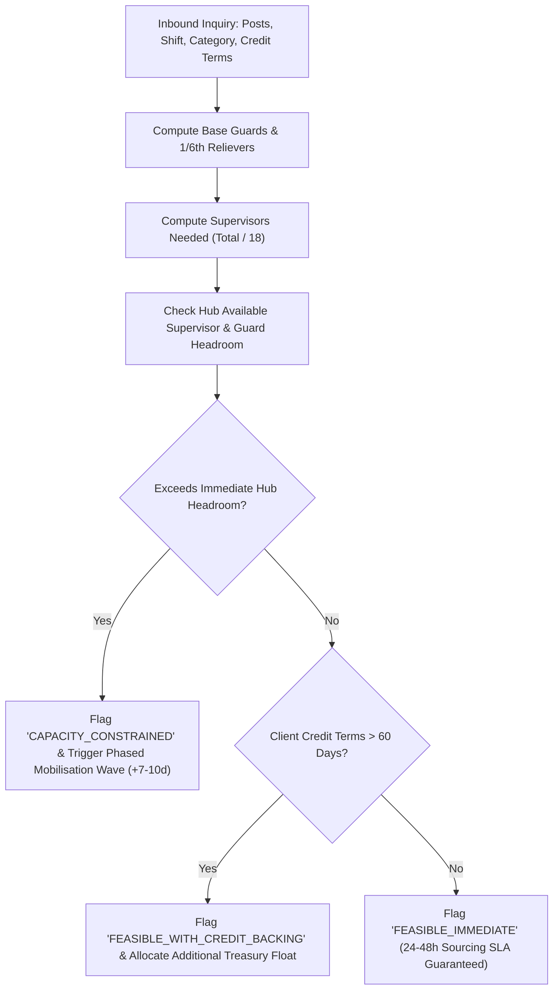

# Advance Corporate Security — Enterprise Workforce Supply Capacity & Operating Float Model

**Document Reference:** ACS-OPS-CAPACITY-2026-V1  
**Blueprint Source:** *Advance Corporate Security — Enterprise 100X Growth + Developer Implementation Blueprint (29 Oct 2026)*, Section 12: *Revenue and Operating Capacity: Replace Hotel Inventory with Workforce Supply*  
**Governing Code:** [`src/lib/capacityModel.ts`](file:///Users/parther/Parther_Technologies/acs/advance-corporate-security-nextjs-web/src/lib/capacityModel.ts), [`WorkforceCapacityCalculator.tsx`](file:///Users/parther/Parther_Technologies/acs/advance-corporate-security-nextjs-web/src/components/calculator/WorkforceCapacityCalculator.tsx), and [`/procurement/workforce-capacity-and-payroll-model`](file:///Users/parther/Parther_Technologies/acs/advance-corporate-security-nextjs-web/src/app/procurement/workforce-capacity-and-payroll-model/page.tsx)  
**Date:** 29 October 2026  

---

## 1. Executive Mandate: Replacing Hotel Inventory with Workforce Supply

In hospitality software (such as the predecessor Yashoda platform), capacity is bounded by fixed physical rooms:  
$$\text{Room Inventory} = 12 \text{ rooms} \times 365 \text{ days} = 4,380 \text{ room-nights max}$$  
Turnover is near-instantaneous (30-minute housekeeping turnaround) and revenue is realized via immediate token deposits.

In B2B enterprise security guarding, integrated facility management (IFM), and corporate manpower outsourcing (ACS), **capacity cannot be treated as fixed inventory or scaled arbitrarily**. Operating capacity is strictly bounded by human governance, statutory rest rules, and financial liquidity:

$$\text{Operational Capacity} = \text{Active Approved Supervisors} \times \left(\frac{\text{Sites}}{\text{Supervisor}}\right) \times \text{Available Verified Staff} \times \text{Affordable Payroll Float}$$

Any contract won that violates this equation results in:
1. **Supervisory Decay:** Unsupervised night posts, absenteeism, and post abandonment.
2. **Statutory Non-Compliance:** Omitting 1/6th reliever rosters forces guards into 30 consecutive 12-hour shifts, violating Chapter VI of the Factories Act 1948 and Section 13 of the Minimum Wages Act 1948.
3. **Cash Flow Bankruptcy:** Accepting enterprise credit terms (Net 30–60 days) without a dedicated 60-day payroll float reserve causes wage defaults on the 7th/10th of the month, triggering statutory notices under Section 21(4) of the CLRA Act 1970 against the Principal Employer.

---

## 2. The Four Mathematical Operating Constraints

### Constraint 1: Supervisory Span of Control (8–10 Sites / 1:15–20 Ratio)
* **Rule:** A single field patrol supervisor cannot effectively manage more than **8 to 10 client physical sites** or **15 to 20 deployed guards per shift**.
* **Operational Rationale:**
  * Every site requires at least **two unannounced night visits per week** (between 01:00 and 04:30 hrs).
  * Supervisors inspect biometric/QR guard patrol logs, verify guard alertness, check breathalyzer tests, and liaise with client site security officers.
  * If an agency exceeds 10 sites per supervisor, night checks drop to near zero, leading directly to gate-pass theft, unauthorized visitor entry, and shrinkage.

### Constraint 2: Statutory 1/6th Reliever Rostering (+16.67% Headcount)
* **Rule:** For any post requiring continuous 24×7 protection (365 days a year), an agency must deploy **1 additional trained reliever for every 6 base guards**:
  $$\text{Relievers Required} = \left\lceil \frac{\text{Base Guards}}{6} \right\rceil$$
  $$\text{Total Headcount} = \text{Base Guards} + \text{Relievers}$$
* **Statutory Reference:**
  * *Minimum Wages Act 1948, Section 13(1)(c):* Mandatory provision for a day of rest for every period of 7 days.
  * *Factories Act 1948, Section 52:* Weekly holidays.
* **Procurement Reality Check:** Contractors offering lowball quotes consistently eliminate reliever allocations. This forces guards into illegal double shifts or leaves posts unattended during weekly offs. ACS rate sheets calculate the 1/6th reliever explicitly.

### Constraint 3: Verified Sourcing & Mobilisation SLAs
Unlike commodity temp agencies, PSARA-licensed enterprise guarding requires verifiable vetting:

| Category | Sourcing SLA | Mandatory PSARA / Training Hours | Screening Requirements |
| :--- | :---: | :---: | :--- |
| **Standard Unarmed Guard** | 24–48 Hours | 160 Hours (100h Theory + 60h Practical) | Police Verification, Aadhaar Biometrics, Medical Fitness |
| **Armed Guard / Ex-Servicemen (ESM)** | 5–7 Days | 200 Hours | Valid Gun License (All-India / State), PBOR Discharge Book |
| **Fire Safety & First Responder** | 5–7 Days | 180 Hours | Certified Fire Marshal Diploma, Red Cross First Aid |
| **Executive Protection (CPO)** | 7–10 Days | 240 Hours | Advanced Defensive Driving, Close Protection Tactical Vetting |
| **Corporate Housekeeping / IFM** | 48–72 Hours | 80 Hours | Machine Scrubbing, Chemical Dilution (MSDS), Bio-waste SOP |

### Constraint 4: Committed 60-Day Liquid Payroll Float Reserve
Enterprise clients routinely operate on Net 30, Net 45, or Net 60-day billing credit terms. However:
* The **Payment of Wages Act 1936** mandates salary disbursement by the **7th or 10th** of the following calendar month.
* The **EPF Act 1952** mandates contribution deposit by the **15th** of the following calendar month.
* **Liquid Reserve Requirement:** ACS must maintain at all times a liquid cash float equal to **at least 2 months (60 days)** of gross monthly payroll for every deployed workforce unit:
  $$\text{Required Float Reserve} = \text{Total Headcount} \times \text{Monthly Gross CTC} \times 2$$

---

## 3. Planning Sensitivity Model (Blueprint Page 6)

The table below reflects the exact 12-month sensitivity trajectories specified on Page 6 of the Master Implementation Blueprint:

| Parameter | Conservative | Base (Target) | Stretch |
| :--- | :---: | :---: | :---: |
| **Target Acquisition Focus** | Organic Inbound & PSU Tenders | Industrial Corridors & Mid-Market IFM | Mega Logistics Parks & Multi-State Corporates |
| **Qualified Leads / Month** | 10 | 25 | 50 |
| **Proposal Submission Rate** | 40% (4 proposals/mo) | 50% (12.5 proposals/mo) | 55% (27.5 proposals/mo) |
| **Contract Win Rate** | 10% | 15% | 20% |
| **Won Enterprise Contracts / Month** | 0.4 (~5 / year) | 1.88 (~22 / year) | 5.5 (~66 / year) |
| **Average Headcount / Contract** | 8 Guards | 15 Guards | 20 Guards |
| **Monthly New Headcount** | 3.2 Guards | 28.2 Guards | 110 Guards |
| **12-Month Cumulative Workforce** | **38 Guards** | **338 Guards** | **1,320 Guards** |
| **Average Monthly Contract Value** | ₹1,60,000 | ₹3,00,000 | ₹4,20,000 |
| **Cumulative 12-Month Run-Rate (ARR)** | **₹91.2 Lakhs** | **₹8.10 Crores** | **₹31.68 Crores** |
| **Committed 60-Day Payroll Float Needed** | **₹15.2 Lakhs** | **₹1.35 Crores** | **₹5.28 Crores** |
| **New Field Supervisors Required** | **+3 Officers** | **+19 Officers** | **+74 Officers** |

---

## 4. Regional Operational Hubs Supply Register

ACS maintains active, verified supervisor rosters and liquid payroll reserves across 6 core industrial operating hubs:

| Hub ID | Regional Hub & Corridor | State / Zone | PSARA Jurisdiction | Active Supervisors | Current Deployed Sites | Active Guards | Capacity Cap | Current Utilization | Payroll Reserve Held |
| :--- | :--- | :--- | :--- | :---: | :---: | :---: | :---: | :---: | :---: |
| `wb-kolkata-central` | Kolkata Metropolitan & North 24 Pgs (HQ) | West Bengal (Zone A) | Direct PSARA Form-V | 18 | 112 | 1,420 | 1,800 | 78.8% | ₹5.80 Crores |
| `wb-howrah-hooghly` | Howrah Logistics & Hooghly Corridor (NH-16/19) | West Bengal (Zone A) | Direct PSARA Form-V | 14 | 84 | 980 | 1,400 | 70.0% | ₹3.90 Crores |
| `wb-durgapur-asansol` | Paschim Bardhaman Industrial Belt | West Bengal (Zone B) | Direct PSARA Form-V | 10 | 52 | 680 | 1,000 | 68.0% | ₹2.50 Crores |
| `wb-siliguri-north` | Siliguri & North Bengal Logistics Hub | West Bengal (Zone B) | Direct PSARA Form-V | 8 | 36 | 420 | 650 | 64.6% | ₹1.60 Crores |
| `ncr-delhi-gurgaon` | Delhi NCR Corporate & Warehousing Hub | Delhi NCR Sphere | Direct PSARA Form-V | 12 | 60 | 720 | 1,100 | 65.4% | ₹3.20 Crores |
| `jh-ranchi-jamshedpur`| Jharkhand Heavy Engineering Corridor | Jharkhand (Area B) | Direct PSARA Form-V | 8 | 44 | 490 | 750 | 65.3% | ₹1.80 Crores |

---

## 5. Enterprise Procurement Feasibility Evaluation Algorithm

When an enterprise procurement enquiry or tender opportunity is received, the feasibility algorithm executes the following sequence:

---

## 6. Verification and Deployment Checklist

- [x] **Mathematical Model:** Implemented in [`src/lib/capacityModel.ts`](file:///Users/parther/Parther_Technologies/acs/advance-corporate-security-nextjs-web/src/lib/capacityModel.ts) with full type definitions and constraint logic.
- [x] **Interactive Simulation Component:** Built in [`WorkforceCapacityCalculator.tsx`](file:///Users/parther/Parther_Technologies/acs/advance-corporate-security-nextjs-web/src/components/calculator/WorkforceCapacityCalculator.tsx).
- [x] **Enterprise Procurement Page:** Published at [`/procurement/workforce-capacity-and-payroll-model`](file:///Users/parther/Parther_Technologies/acs/advance-corporate-security-nextjs-web/src/app/procurement/workforce-capacity-and-payroll-model/page.tsx) with JSON-LD Breadcrumb & FAQ schemas.
- [x] **Procurement Portal Navigation:** Updated [`/procurement/page.tsx`](file:///Users/parther/Parther_Technologies/acs/advance-corporate-security-nextjs-web/src/app/procurement/page.tsx) hero links and 6-guide grid.
- [x] **Backend Validator:** Built in [`advance-corporate-security-nodejs-backend/src/utils/capacityValidator.ts`](file:///Users/parther/Parther_Technologies/acs/advance-corporate-security-nodejs-backend/src/utils/capacityValidator.ts).
- [x] **Zero Touch on Protected Assets:** Homepage `HeroSection.tsx` preserved without any modification.
